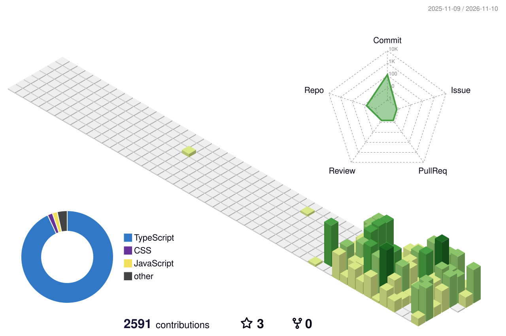

  

  

## สวัสดีครับ 👋

ผมเป็น Web Developer ที่ทำระบบงานให้องค์กร ตั้งแต่ฟอร์มกรอกข้อมูลและสิทธิ์ผู้ใช้ ไปจนถึงรายงาน PDF

*Web developer building systems for organisations: forms, user permissions and PDF reports.*

- 🏥 งานประจำคือพัฒนาระบบสารสนเทศโรงพยาบาล ร่วมกับแพทย์ พยาบาล และฝ่ายการเงินที่หน้างาน
- 🧩 สร้าง **Nuxel** แพลตฟอร์ม low-code ของตัวเองสำหรับประกอบระบบงานองค์กร (repo เป็น private)
- 🏆 **Medimove** ได้ที่ 1 ในงาน Advantech AIoT InnoWorks Thailand 2024

## เครื่องมือที่ใช้

  

และ Nuxt UI · Drizzle ORM · Zod · Vitest

## ผลงาน

| โปรเจกต์ | ทำอะไร | ใช้อะไร |
|---|---|---|
| [api-vault](https://github.com/VoramethP/api-vault) · [demo](https://api-vault-two.vercel.app) | คลัง API สาธารณะที่ค้นเป็นภาษาไทยได้ และที่เก็บ API key แบบเข้ารหัส | Nuxt 4 · Supabase · Drizzle |
| [dlt-plate-watcher](https://github.com/VoramethP/dlt-plate-watcher) | เฝ้าตารางเปิดจองเลขทะเบียนรถของกรมการขนส่งทางบก แล้วแจ้งเตือนเข้า Discord (แจ้งอย่างเดียว ไม่จองแทน) | TypeScript · PostgreSQL · Vercel |
| [kidney-stone-detector](https://github.com/VoramethP/kidney-stone-detector) · [demo](https://voramethp.github.io/kidney-stone-detector/) | หานิ่วในไตจากภาพฟิล์มด้วยโมเดล YOLOv8 ที่เทรนเอง | Python · YOLOv8 · JavaScript |
| [Medimove](https://github.com/VoramethP/Medimove-Project-website) | เว็บของโปรเจกต์ Medimove ที่ได้ที่ 1 ในงาน Advantech AIoT InnoWorks Thailand 2024 | HTML · CSS |

## สถิติ

<!-- ปิดไว้ชั่วคราว 4 พ.ย. 2026: บริการสาธารณะ trophy / readme-stats / streak-stats / activity-graph เกินโควตา (402/503)
     เปิดกลับเมื่อย้ายไป host เองบน Vercel ของเราแล้ว

  

  
  

  

  

-->

  

  <picture>
    <source media="(prefers-color-scheme: dark)" srcset="https://raw.githubusercontent.com/VoramethP/VoramethP/output/github-snake-dark.svg" />
    
  </picture>

## ติดต่อ

